# syncat architecture

This document explains how the code is organized and how the parts work
together. Read [README.md](README.md) for user tasks. Read [SPEC.md](SPEC.md)
for design rules. A reference such as §5 means a section in SPEC.md.

The diagrams use Mermaid. GitHub and most Markdown viewers render them.

Source files use `// --- section ---` markers. Run this command to list the
sections in a file:

```bash
grep '^// --- ' path/to/file.go
```

## Contents

1. [Overview](#overview)
2. [Package map](#package-map)
3. [Packages](#packages)
4. [How the packages work together](#how-the-packages-work-together)
5. [Concurrency rules](#concurrency-rules)
6. [Security boundaries](#security-boundaries)
7. [Data on disk](#data-on-disk)
8. [Tests](#tests)
9. [Where to look](#where-to-look)

## Overview

syncat is one Go binary. `syncat daemon` runs a **node**. A node:

- has an Ed25519 identity key,
- offers local directories as **shares**,
- copies other nodes' shares into local directories as **subscriptions**,
- connects to configured **peers** through tailcat,
- keeps one SQLite index of every file it syncs,
- compares its index with each peer's index and moves file data to match,
- serves a loopback-only REST API and an embedded web UI.

Every other CLI command is a client of the REST API, except the commands
that only read or write local files (`init`, `token`, `config`, `version`).
This gives the SQLite database one owner process.

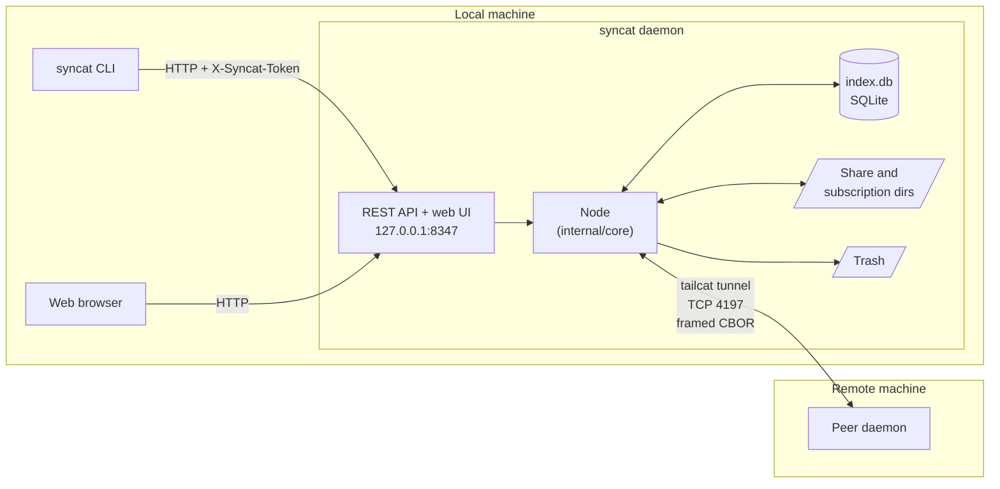

## Package map

Packages import down this graph. An arrow means "imports".

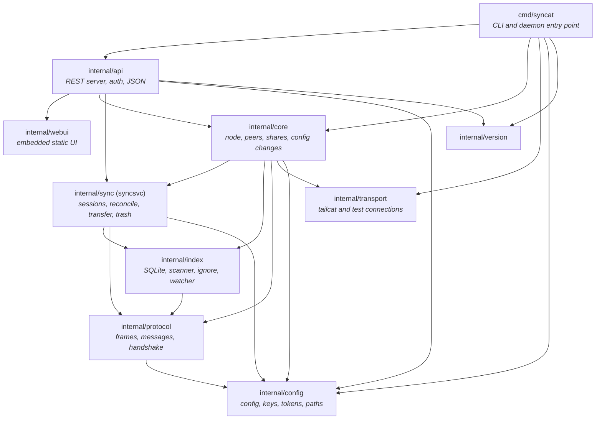

Dependency rules:

- `internal/core` and every package below it must not import HTTP, CLI, or
  UI code (§12).
- All packages must build with `CGO_ENABLED=0`. The SQLite driver is pure Go.
- `internal/config`, `internal/transport`, `internal/version`, and
  `internal/webui` are leaf packages. They import no other syncat package.
- `internal/protocol` imports `config` only to parse `sc1` tokens.
- `internal/index` imports `protocol` only for `FileInfo`, `FileType`, and
  `VersionVector`.
- `internal/transport` returns a plain `net.Conn`. It knows nothing about the
  protocol that runs on that connection.
- `internal/api` imports `internal/sync` only for the `TrashEntry` type.

### Package summary

| Package | One-line role | Main types |
|---|---|---|
| `cmd/syncat` | Parse CLI commands. Run the daemon or call its API. | `command`, `apiClient` |
| `internal/api` | Expose the node over loopback HTTP as JSON. | `Server` |
| `internal/webui` | Serve the embedded single-page UI. | `Handler`, `Assets` |
| `internal/core` | Own the running node and connect every other part. | `Node`, `peerConn`, `shareWatch`, `Status` |
| `internal/sync` | Keep shares in agreement with one peer over one connection. | `Session`, `Action`, `Direction`, `Trash`, `Janitor` |
| `internal/index` | Record what is on disk and what peers report. | `Store`, `Scanner`, `Watcher`, `Matcher` |
| `internal/protocol` | Define and encode the peer wire protocol. | `MsgType`, `Reader`, `StreamWriter`, `Keepalive` |
| `internal/transport` | Create connections to peers. | `Transport`, `TailcatTransport`, `PipeTransport`, `Supervisor` |
| `internal/config` | Load and save config, keys, and tokens. | `Config`, `Paths`, `IdentityKey`, `NodeToken` |
| `internal/version` | Report the product version and build commit. | — |

## Packages

The packages are described from the bottom of the graph to the top.

### `internal/config`

**What it does.** This package owns every file below the config and data
directories. It knows the config schema, the key formats, and the token
format. It does not start anything or talk to the network.

| File | Purpose |
|---|---|
| `config.go` | `Config`, peers, pending peers, shares, subscriptions, defaults, validation, JSON load and save, and share/subscription path overlap checks |
| `keys.go` | Ed25519 identity key, tailcat key, `sc1` token encode and parse, and API token |
| `paths.go` | XDG path resolution and atomic file writes |

**Details.**

- `Config` is an in-memory Go struct. Separate document types define the JSON
  format. The program can apply defaults and change the JSON format without
  spreading document rules into other packages. The specification names TOML.
  The implementation uses JSON to avoid a TOML dependency.
- A `Share` has a random 16-character hex ID, a name, a path, a permission
  (`read-only` or `read-write`), an `ApprovalRequired` flag, and an `Access`
  map from peer key to access state.
- A `Subscription` names a peer key, a share ID, a local path, a mode
  (`mirror` or `receive-only`), and a `Paused` flag.
- A `PendingPeer` is an unknown node that connected with a valid handshake. It
  keeps that node's token so that approval needs no second paste.
- An `sc1` token holds the node's tailcat address, its Ed25519 public key, and
  its name. `EncodeToken` and `ParseToken` convert it.
- `CheckSharePath` and `CheckSubscriptionPath` reject overlapping directories.
  Two share IDs over one directory would sync forever.
- All writes use a temporary file and a rename.

### `internal/transport`

**What it does.** This package gives the rest of the program a `net.Conn` to a
peer. It hides tailcat behind a small interface so tests can use in-memory
pipes instead.

| File | Purpose |
|---|---|
| `transport.go` | `Transport` interface, exponential-backoff `Supervisor`, and the duplicate-connection rule |
| `tailcat.go` | `TailcatTransport`, the production transport |
| `pipe.go` | `PipeTransport`, an in-memory `net.Pipe` transport for tests |

**Details.**

- `Transport` has five methods: `Start` (accept inbound connections), `Dial`,
  `DiscardPeer` (drop cached per-peer state after a disconnect), `LocalAddress`
  (for the node's own token), and `Close`.
- `TailcatTransport` serves only TCP port 4197 (`SyncatPort`). It carries the
  connection through a WireGuard tunnel relayed through DERP.
- `Supervisor.Run` calls a dial function in a loop. After a failure it waits
  with exponential backoff: 1 s initial, factor 2, 5 min maximum, 50% jitter.
- Two peers can dial each other at the same time. `KeepConnection` uses both
  public keys and the dial direction to choose one connection. Both peers
  reach the same answer without talking to each other (§2.4).

### `internal/protocol`

**What it does.** This package defines the bytes that flow between two nodes:
message types, framing, the authentication handshake, the keepalive timer,
and a prioritized writer. It does not know about shares, files on disk, or
SQLite.

| File | Purpose |
|---|---|
| `message.go` | Message types and structs, frame codec, message validation, and size limits |
| `stream.go` | `StreamWriter`: one writer goroutine with prioritized, bounded queues |
| `handshake.go` | Mutual Ed25519 handshake, version negotiation, and typed rejection |
| `keepalive.go` | Ping/Pong timing and dead-connection detection |
| `diagnostic.go` | Sanitize and redact text that comes from a peer |

**Frame format.**

```text
+----------------+-------------+---------------------------+
| length (4 B)   | type (1 B)  | CBOR body                 |
+----------------+-------------+---------------------------+

FileChunk:
+----------------+-------------+-------------+-------------+
| length (4 B)   | type (1 B)  | CBOR header | raw bytes   |
+----------------+-------------+-------------+-------------+
```

A frame is at most 4 MiB. A `FileChunk` carries at most 1 MiB of file data.
The raw data follows the CBOR header, so file bytes are not CBOR-encoded.
Messages are CBOR maps with string keys, so a newer peer can add fields
without breaking an older one (§11).

**Message groups.** The current protocol version is 3.

| Group | Messages | Handled by |
|---|---|---|
| Handshake | `Hello`, `Auth` (also carries `HelloAuth`), `Finished`, `Error` | `protocol/handshake.go` |
| Control | `ShareList`, `SubscribeRequest`, `AccessUpdate`, `Ping`, `Pong` | `core/peer.go`, `core/access.go` |
| Index | `IndexSyncRequest`, `IndexSnapshotBegin`, `IndexSnapshotBatch`, `IndexSnapshotEnd`, `IndexDeltaBatch`, `IndexAck`, `IndexUpdate` | `sync/dispatch.go`, `sync/session.go` |
| Transfer | `FileRequest`, `FileChunk`, `CancelTransfer`, `Error` | `sync/transfer.go` |

**Handshake.** Both sides prove that they hold their Ed25519 keys. Each side
signs a transcript of both `Hello` messages plus its role. The whole handshake
has a 30 s deadline.

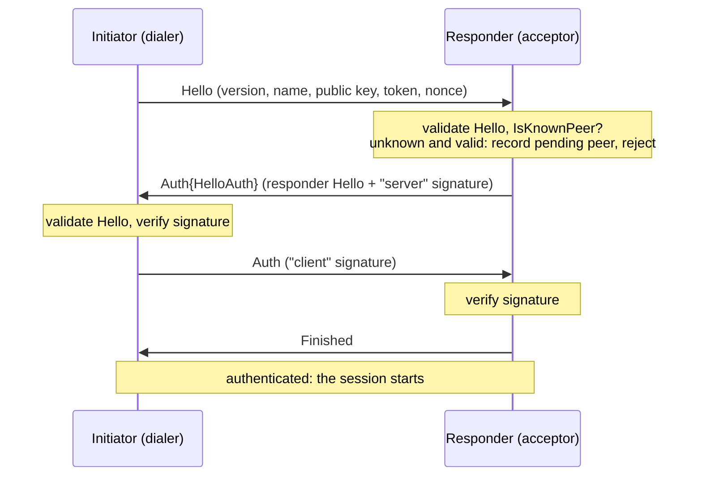

**StreamWriter.** Many goroutines write to one connection. The
`StreamWriter` puts every frame in one of four queues. One goroutine drains
them to the socket.

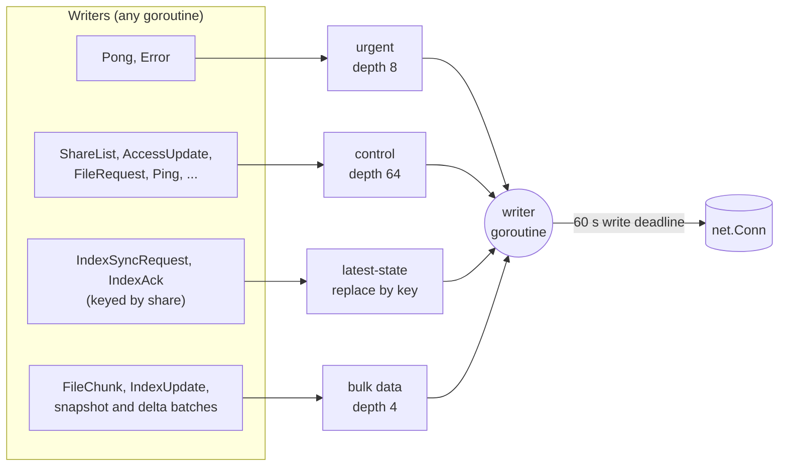

- Urgent frames always go first. A Pong never waits behind a 1 MiB chunk.
- Control frames go next. At most 8 control frames go in a row, so bulk data
  still makes progress.
- A latest-state frame replaces a pending frame with the same key. Repeated
  cursor updates cannot fill the queue.
- The bulk queue is shallow on purpose. A full queue blocks the producer. This
  is the backpressure that stops a file server from racing ahead of the
  network.
- A write failure is terminal. The writer closes the connection, which ends
  the session's read loop.

**Keepalive.** A node sends `Ping` after 30 s with no outgoing traffic. It
declares the connection dead after 90 s with no incoming traffic. Any frame
counts as traffic.

### `internal/index`

**What it does.** This package records the node's view of each share in
SQLite. It also walks share directories, applies ignore rules, and watches
for file changes. It does not use the network and does not decide how to
resolve conflicts.

| File | Purpose |
|---|---|
| `store.go` | SQLite store, schema migrations, `files` and `peer_files` tables, and scan-result application |
| `syncstore.go` | Change journal, peer cursors, snapshot staging, and incremental peer updates |
| `scanner.go` | Directory walk, change classification, file hashing, and the ignore `Matcher` |
| `ignore.go` | `.syncatignore` parser (gitignore syntax) |
| `watcher.go` | fsnotify watcher, 1 s debounce, and periodic rescan |

**Tables.**

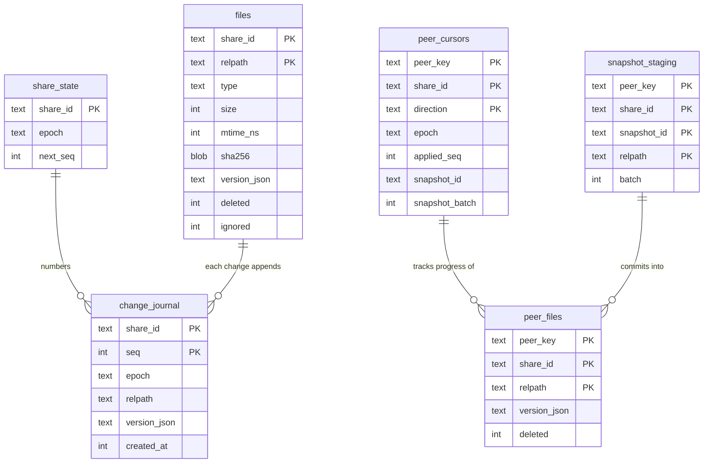

| Table | Contents |
|---|---|
| `files` | This node's own view of every path in every share. A deleted file is a tombstone row with `deleted = 1`. |
| `peer_files` | The last view received from each peer for each share. |
| `share_state` | Each share's journal epoch and next sequence number. |
| `change_journal` | One row for each change to `files`, in order. Peers replay it for incremental updates. |
| `peer_cursors` | How far each peer's index stream has progressed, in each direction. |
| `snapshot_staging` | Snapshot batches received but not yet committed. |
| `pending_transfers` | Reserved for resumable transfers. Nothing uses it yet. |

**Details.**

- The store uses WAL mode. Readers never block the single writer. Every write
  opens and commits its own transaction.
- `Scanner.Scan` reads through an `fs.FS`. It compares the tree with the
  existing rows and returns a `ScanResult` with five buckets: `Added`,
  `ContentChanged`, `MetadataOnly`, `Deleted`, and `Ignored`. It hashes a file
  only when its size, mtime, or mode changed.
- The scanner does not change the database. The caller bumps version vectors
  and then calls `Store.ApplyScanResult`.
- When a new ignore rule matches an indexed path, the row is **parked**
  (`ignored = 1`), not tombstoned. A tombstone would tell peers to delete
  their copies. The parked row keeps its version vector. If the rule is
  removed later, the file can sync again.
- The `Matcher` combines built-in ignores, the global ignore list, and the
  share's `.syncatignore`.
- The `Watcher` adds an fsnotify watch for each directory. It collects events
  for 1 s and then calls back once. It also calls back on a timer (300 s by
  default), because fsnotify can miss events.
- The scanner does not follow symbolic links.

### `internal/sync`

**What it does.** This package keeps a set of shares in agreement with **one**
peer over **one** connection. A `Session` exchanges indexes, decides what to
do with each path, pulls and serves file data, and changes the local file
system. The package is imported as `syncsvc` because its name conflicts with
the standard `sync` package.

| File | Purpose |
|---|---|
| `session.go` | `Session` lifecycle, the read loop, index synchronization, reconcile passes, and bounded work |
| `dispatch.go` | Decode, validate, and schedule each received data-plane frame |
| `reconcile.go` | Version vectors, the `Reconcile` function, conflicts, and direction rules. No I/O. |
| `transfer.go` | Pull and serve file data, cancel transfers, and detect stalls |
| `apply.go` | Carry out actions on disk and move replaced files to the trash |
| `path.go` | Validate a peer path and join it to a share root |
| `trash.go` | Trash store, restore, and the retention `Janitor` |

**Session anatomy.** `Session` spans four files. `session.go` owns lifecycle
and index work. `dispatch.go` checks and schedules received frames.
`transfer.go` moves data. `apply.go` changes the file system.

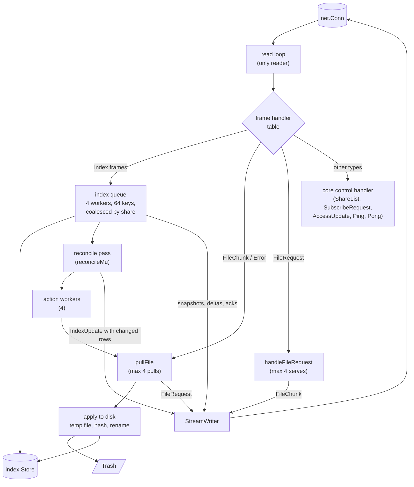

**Reconcile.** `Reconcile` compares local rows with the peer's rows and
returns one `Action` for each path. It performs no I/O.

| Action | Meaning |
|---|---|
| `None` | Nothing to do. The versions are equal, the peer will pull from us, the path is ignored, or the direction blocks it. |
| `Pull` | The peer's version dominates. Fetch its content. |
| `Delete` | The peer's tombstone dominates. Move the local file to the trash. |
| `Resurrect` | One side deleted and the other side modified. The modification wins. |
| `ConflictCopy` | Both sides changed the content. The winner keeps the name. The loser is kept beside it under a conflict name. |
| `LocallyModified` | A receive-only subscription has a local change. Flag it and revert it from the peer's copy. |

Version vectors map a node's short ID to a counter. A local content change
bumps the node's own counter. `Dominates`, `Concurrent`, `Merge`, and `Bump`
implement the algebra in §5.

**Direction.** `DirectionFor(permission, mode)` builds a `Direction`:

- `InboundBlocked` is set on the offerer of a `read-only` share. It ignores
  every incoming change.
- `OutboundBlocked` is set on a `receive-only` subscriber. It never proposes
  its own changes.

**Transfer.** A pull sends `FileRequest` with a transfer ID, the path, and the
expected version. The server checks that its version still matches, then
streams `FileChunk` frames. Chunks for up to four pulls interleave on the one
connection. The read loop routes each chunk by transfer ID. A pull fails if 60
s pass without a chunk or an error.

**Apply.** A pulled file goes to a `.syncat.tmp.*` file beside its
destination. syncat checks the size and SHA-256, moves any existing file to
the trash, and renames the temporary file into place. `SweepTempFiles` removes
temporary files left by a crash. It runs at startup.

**Trash.** `Trash.Put` moves a file to
`trash/<share-id>/<relpath>.<unix-time>`. `Trash.Restore` moves it back and
writes a new index row. The `Janitor` deletes entries older than the retention
period (30 days by default).

### `internal/core`

**What it does.** This package **is** the node. It owns startup and shutdown,
the configuration, one connection manager for each peer, one watcher for each
local directory, and the approval queues. It connects the lower packages to
each other and gives the API a typed Go interface. It never encodes JSON.

| File | Purpose |
|---|---|
| `node.go` | `Node`, `Open` and `Close`, inbound connection admission, and test clocks |
| `peer.go` | `peerConn`: dial, handshake, deduplication, session start, keepalive, and teardown for one peer |
| `access.go` | Share list, subscription requests, access decisions, and access updates |
| `approvals.go` | Persisted queues of pending peers and pending share requests |
| `shares.go` | `shareWatch`, rescans, version bumps, and propagation to peers |
| `journal.go` | Daily change-journal pruning (7-day retention) |
| `mutations.go` | Config changes called by the API |
| `mutation_error.go` | Typed errors for mutations |
| `resolve.go` | Resolve names and ID prefixes to peers and shares |
| `network_status.go` | Low-cardinality network and session counters |
| `status.go` | `Status` snapshot and rejected-connection history |

**Node state.**

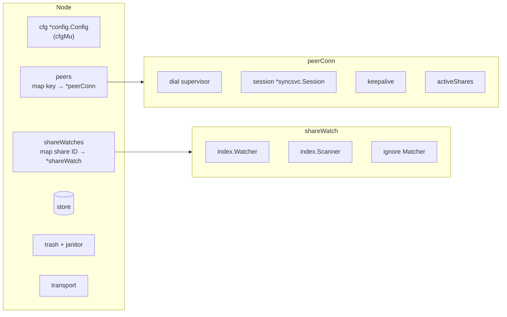

**Details.**

- `peerConn` holds at most one adopted connection. `offer` applies
  `KeepConnection`. The losing connection is closed. A second winning
  connection is closed as redundant.
- When a connection is adopted, core creates a `Session`, connects the session
  to the trash, the keepalive, and the control handler, and then sends the
  share list and subscription requests.
- `provisionShareForRequest` and `provisionAccessUpdate` run on the session's
  read-loop goroutine. The share must be known to the session before the next
  frame is read, because the peer sends index data right after a grant.
- A share that needs approval queues a request. An operator grants or denies it
  through the API. An unknown peer that completes a valid `Hello` is saved as a
  pending peer (at most 128).
- A removed or revoked share cannot be removed from a live session. Core
  "neuters" it by setting both direction flags. A new connection never adds it
  again.
- `peerConn.grantShare`, `reconfigureShare`, and `neuterShare` are the only
  code that changes which shares a session syncs. Each one updates the
  session's share table and `activeShares` together under `pc.mu`.
- Inbound admission is limited to 32 concurrent handshakes and 4 for each
  known peer.

**Peer connection states.**

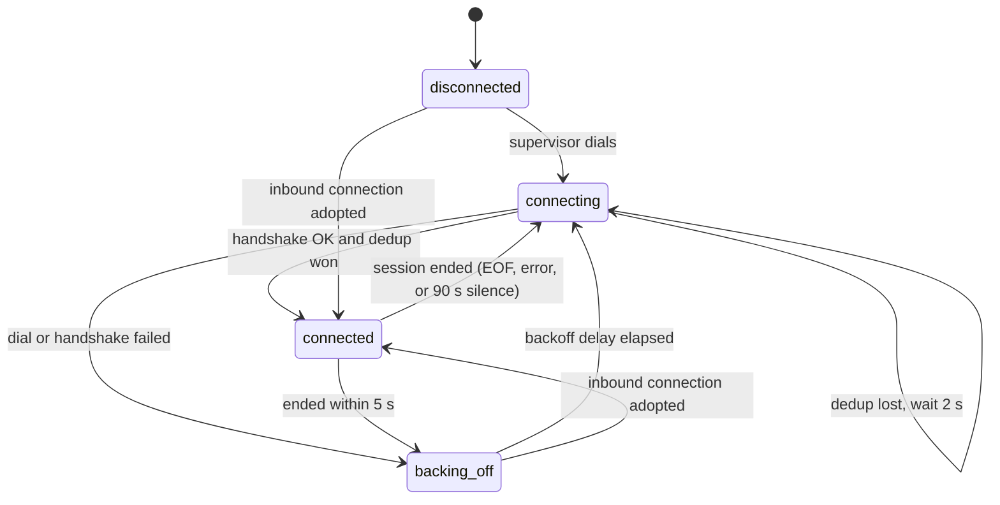

### `internal/api` and `internal/webui`

**What they do.** `internal/api` turns HTTP requests into calls on
`core.Node` and turns core values into JSON. `internal/webui` embeds the
hand-written single-page UI (`index.html`, `app.js`, `style.css`) with
`go:embed`. There is no build step for the UI.

| File | Purpose |
|---|---|
| `api/server.go` | Loopback listener, routes, token check, `/ui-token`, middleware, and HTTP helpers |
| `api/handlers.go` | One handler for each API operation |
| `api/dto.go` | JSON response types and converters from core types |
| `webui/embed.go` | Embedded files and a static file handler with fixed content types |

**Routes.**

| Method and path | Core call |
|---|---|
| `GET /api/status` | `Node.Status` |
| `PATCH /api/node` | `RenameNode` |
| `GET, POST /api/peers`, `DELETE /api/peers/{id}` | `Status`, `AddPeer`, `RemovePeer` |
| `POST /api/peers/{id}/approve` | `ApprovePendingPeer` |
| `GET /api/approvals`, `POST /api/approvals/{id}` | `Approvals`, `DecideApproval` |
| `GET, POST /api/shares`, `PATCH, DELETE /api/shares/{id}` | `AddShare`, `RenameShare`, `SetSharePermission`, `SetShareApprovalRequired`, `SetShareAccess`, `RemoveShare` |
| `GET /api/remote-shares` | `Status` |
| `GET, POST /api/subscriptions`, `PATCH, DELETE /api/subscriptions/{id}` | `AddSubscription`, `PauseSubscription`, `RemoveSubscription` |
| `GET /api/shares/{id}/trash`, `POST /api/shares/{id}/trash/restore` | `ListTrash`, `RestoreTrash` |
| `GET /ui-token` | Returns the API token to the web UI |
| `GET /` | Embedded web UI |

**Details.**

- Every `/api/` route checks `X-Syncat-Token` with a constant-time comparison.
- `/ui-token` and the static UI are the only unauthenticated routes.
  `/ui-token` checks the remote address, `Host`, and `Origin` before it returns
  the token.
- The UI polls `GET /api/status`. There is no event stream.
- Handlers map `core.MutationError` kinds to HTTP status codes. The API never
  returns `internal/sync` types directly.

### `cmd/syncat`

**What it does.** This is the `main` package. It parses commands. `daemon`
builds and runs the node. Most other commands send one API request and print
the result.

| File | Purpose |
|---|---|
| `main.go` | Global flags, command table, and usage |
| `client.go` | API client: reads the API token and address, sends requests |
| `cmd_node.go` | `init`, `token`, `version`, `config`, `daemon`, and `status` |
| `cmd_peer.go` | `peer`, `remote`, and `approvals` |
| `cmd_share.go` | `share`, `subscription`, and `trash` |
| `owner_unix.go`, `owner_other.go` | File-owner checks for `init --reset` |

**Details.**

- `init`, `token`, `config`, and `version` read and write local files. They
  work without the daemon.
- `daemon` loads config and keys, binds the API listener, creates the tailcat
  transport, calls `core.Open`, and serves HTTP. On `SIGINT` or `SIGTERM` it
  stops the HTTP server, then closes the node.

### `internal/version`

This package holds the product version and the build commit ID. The daemon
reports it in status. `syncat version` prints it.

## How the packages work together

### Start a daemon

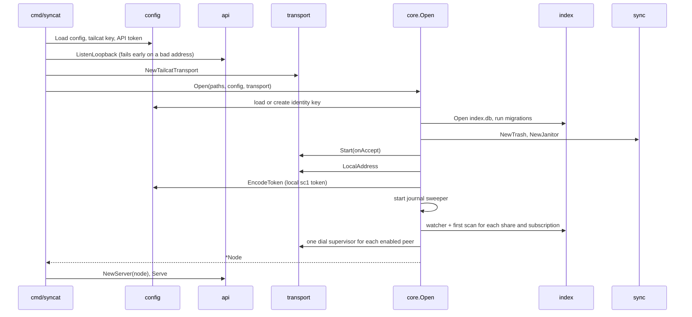

On a start failure, cleanup closes the janitor, the store, and the transport.
On shutdown, the node cancels its context, waits for every tracked goroutine,
then closes watchers, trash, store, and transport.

### Connect to a peer

Inbound and outbound connections use the same path after the handshake.

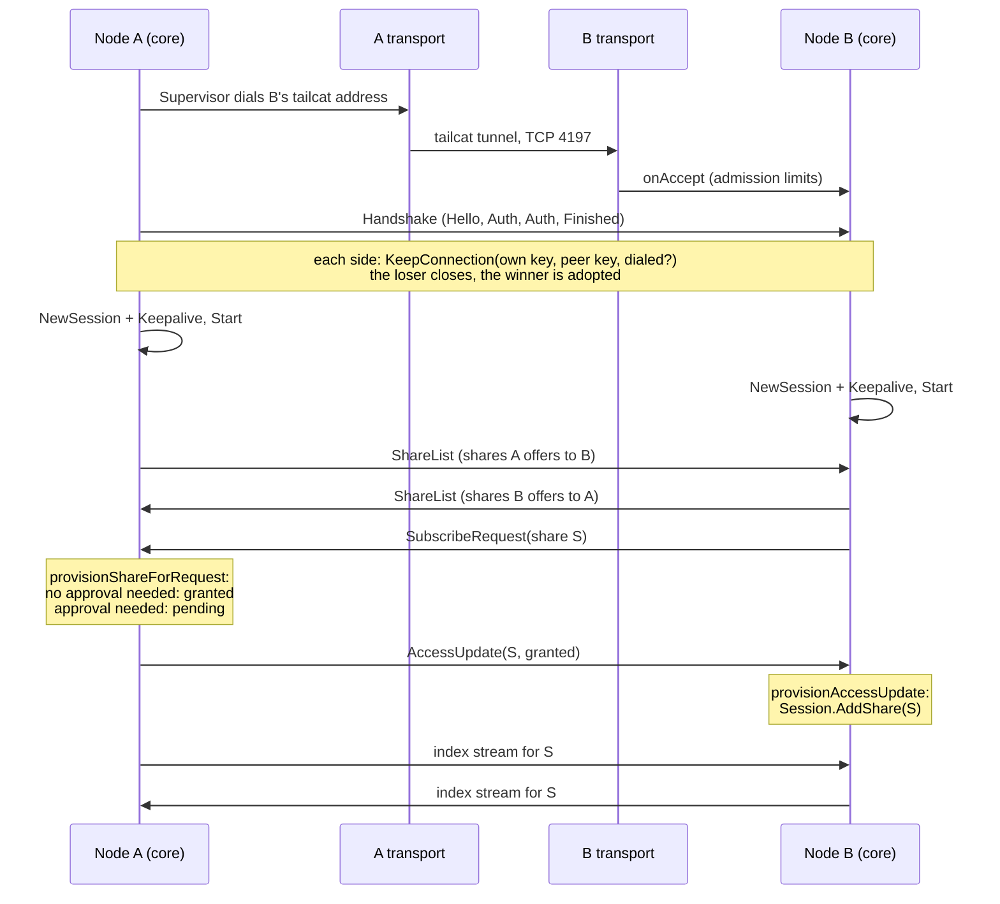

When a session ends, core cancels its work, waits for the keepalive, closes
the session and the connection, calls `Transport.DiscardPeer`, and lets the
supervisor dial again.

### Scan a local change and tell peers

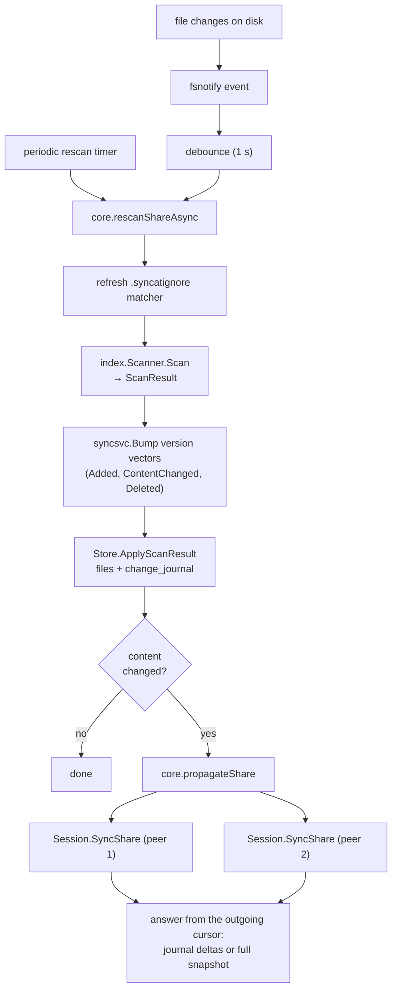

A metadata-only change (such as `touch`) updates the row but does not bump the
version vector and does not propagate.

### Exchange an index and move files

The session's read loop is the only reader of its connection. It validates
each message, checks share access, and hands work to bounded workers.

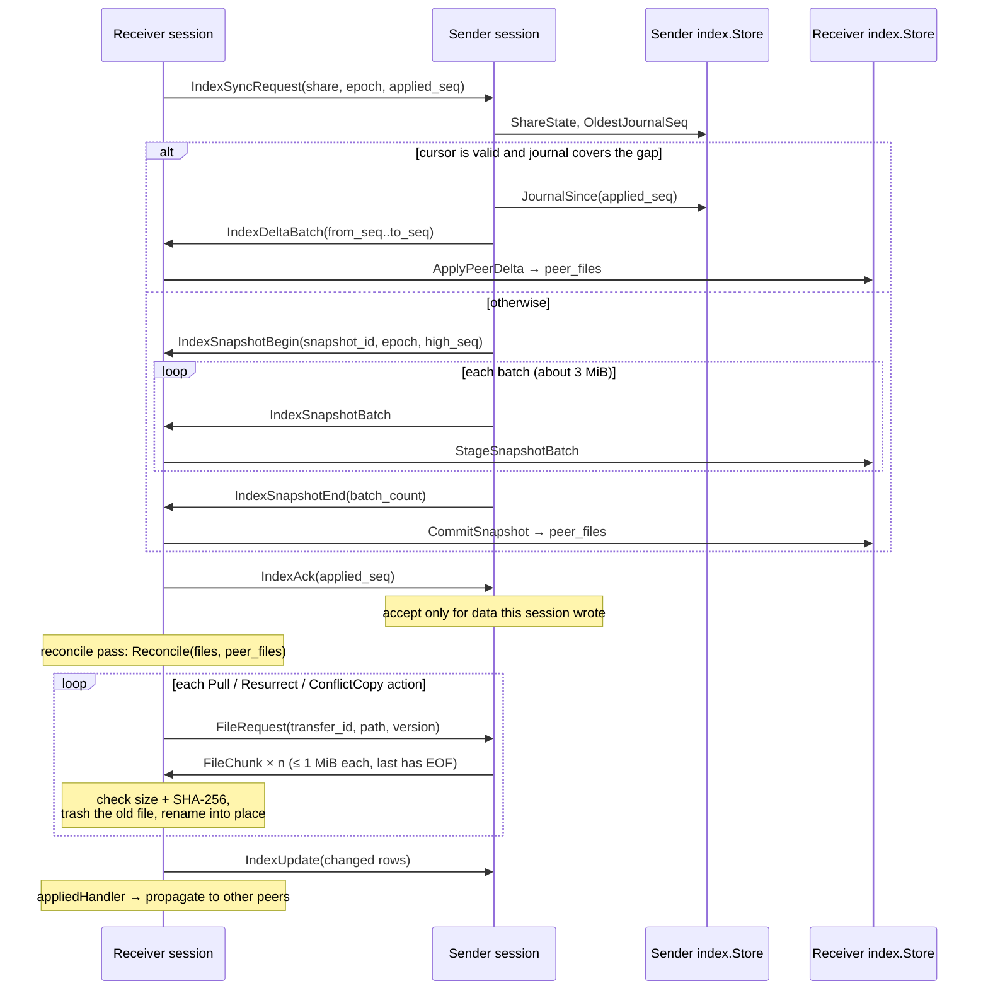

- A delta batch must continue exactly from the receiver's cursor. If it does
  not, the receiver asks again and receives a snapshot.
- The journal keeps 7 days of changes. A peer that was away longer receives a
  snapshot.
- Repeated index work for one share replaces pending work. It does not create
  an unbounded queue.
- A reconcile pass also runs when a share becomes active on a new connection.
  This finishes pulls that an earlier connection left incomplete.

### Fan-out through the offerer

Subscribers of the same share never connect to each other for that share. The
offerer relays every change.

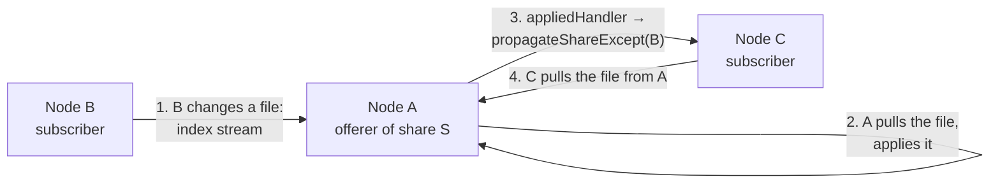

### Change config through the API

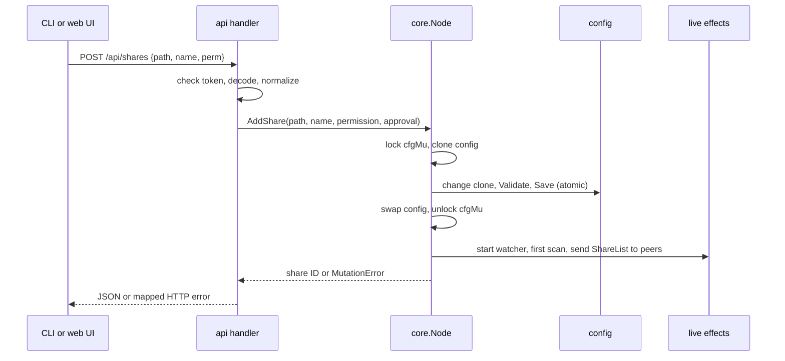

Live effects start only after `cfgMu` is released. This keeps the config lock
out of peer and session locks.

## Concurrency rules

- The transport has one accept loop. The node tracks every background
  goroutine and waits for them on `Close`.
- A peer has one dial supervisor. A live connection has a session read loop, a
  stream writer, a keepalive loop, and a connection owner goroutine.
- A session has bounded index workers (4), pulls (4), and serves (4).
- The index queue holds at most 64 keys and coalesces repeated work by share.
- The read loop never waits for work that needs the read loop to deliver more
  input. Otherwise a pull could deadlock against the loop that delivers its
  chunks.
- One reconcile pass runs at a time for each session (`reconcileMu`).
- `cfgMu` is not held when code takes a `peerConn` lock.
- The stream writer is the only writer of a session connection.
- Every timer goes through an injectable clock. Tests control time without
  waiting.

## Security boundaries

### Tailcat admission

An `sc1` token contains a tailcat address. The address contains the tailcat
server public key, discovery data, DERP region, and WireGuard pre-shared key.
The token is a bearer credential for the tailcat transport.

`TailcatTransport` does not set `tailcat.Server.AllowedClients`. The server
therefore accepts an ephemeral tailcat client key when the client has the
server address and pre-shared key. This admission occurs before the syncat
Ed25519 handshake.

The tailcat server has a narrow data path:

- `OnTCP` returns a handler only for TCP port 4197.
- `ServedTCPPorts` applies a second restriction to TCP port 4197.
- The server does not configure a UDP handler.
- The server does not configure TCP or UDP forwarding.

Tailcat uses a userspace network stack for this connection. This configuration
does not create a host network interface. It does not route traffic to the
host network or local network. For application traffic, a token holder can
reach only the syncat service on TCP port 4197.

Tailcat v0.6.0 keeps each admitted ephemeral client key in the server client
map until the server stops. A token holder can create multiple client keys.
Each new key increases transport state and rebuilds the tailcat network map.
This behavior creates a resource-exhaustion risk before syncat authentication.

### Application authorization

The syncat handshake verifies both Ed25519 identities after tailcat creates the
TCP connection. The received token identity must match the public key in the
handshake. The public key must also identify a configured peer.

A valid unknown peer becomes a pending approval. It does not get a session.
The node limits the total number of concurrent application handshakes. It also
limits concurrent handshakes for each known peer. These limits do not limit all
work in the tailcat transport.

The signed handshake data is not bound to the tailcat connection or its client
key. An attacker can first replace a configured peer token with a token for an
attacker-controlled tailcat server. The attacker can then relay the signed
handshake to the expected peer on a second tailcat connection. The peers
authenticate each other, but the attacker terminates both encrypted
connections. The attacker can read or change the application traffic. Section
11 of SPEC.md records future work for this boundary.

### Compromise impact

A stolen node token permits tailcat admission to the node that issued the
token. It does not provide the Ed25519 private key that authorizes a syncat
session. It still exposes tailcat, frame decoding, and handshake processing to
the token holder.

A complete copy of a node state includes `identity.key` and all configured peer
tokens. An attacker can use the identity key to impersonate that node to peers
that still trust it. The attacker can use existing share grants. The attacker
can also request access to shares that do not require approval.

This access applies only to direct syncat peers. The transport does not provide
general access to other hosts or services. A separate compromise of the host
operating system can provide more access than syncat provides.

The REST API is a local control interface. It accepts loopback connections
only, and API requests need `X-Syncat-Token`. This design protects against
remote API clients. It does not treat another process with the same user
identity as hostile.

### File-system safeguards

- Every peer path passes through `ValidateRelPath` and `JoinSharePath`.
  `Reconcile` drops a remote row with an invalid path.
- A remote delete or overwrite moves the old file to the trash first.
- A local delete does not use the trash.
- A pulled file is written to a temporary file and checked against its
  SHA-256 before it replaces anything.
- The scanner does not follow symbolic links.

## Data on disk

syncat does not encrypt data at rest. Encoding data as hexadecimal, JSON, CBOR,
or base64 does not encrypt the data. Files that contain credentials have mode
`0600`. Directories that syncat creates have mode `0700`.

| Path | Contents | Confidentiality impact |
|---|---|---|
| `~/.config/syncat/config.json` | Configuration and peer or pending-peer tokens | Each token gives tailcat admission to the node that issued it. |
| `~/.config/syncat/api.token` | REST API token | A local process can control the daemon when it can also reach the loopback API. |
| `~/.local/share/syncat/keys/identity.key` | Ed25519 private identity key | The key can impersonate this syncat node. |
| `~/.local/share/syncat/keys/tailcat.key` | Tailcat private key and WireGuard pre-shared key | The key can reproduce this node's tailcat server identity and address. |
| `~/.local/share/syncat/db/index.db` | File metadata, hashes, peer state, and journal data | The database can disclose names and synchronization history. |
| `~/.local/share/syncat/trash/...` | File content that syncat replaced or deleted | The trash can contain sensitive historical content. |

The file modes prevent access by other unprivileged users when ownership and
directory permissions are correct. They do not prevent access by the same
user or by root. Full-disk encryption can protect a powered-off device. It
does not protect data after the operating system or daemon decrypts it.

The index key is `(share_id, relpath)`. Do not offer a subscription directory
as a share. The two share IDs would cause repeated synchronization.
`config.CheckSharePath` rejects this case.

## Tests

- Each package has unit tests beside its source files.
- `PipeTransport` supports in-process tests of two or more nodes.
- Protocol tests include decoder fuzzing.
- Sync tests include adversarial, concurrency, admission, and integration
  cases.
- API tests call the HTTP handlers.
- `scripts/e2e.sh` tests two live daemons through tailcat.
- `scripts/run-net-tests.sh` runs the live network cases in `scripts/net/`:
  peering, restarts, hard kills, offline divergence, peer removal, permission
  changes, three-node fan-out, ignore rules, dead peers, idle stability, large
  files, and restarts during a transfer.

Run these checks:

```bash
gofmt -l .
go vet ./...
CGO_ENABLED=0 go build ./...
go test -count=1 ./...
go test -race ./internal/core ./internal/sync ./internal/protocol
scripts/e2e.sh
scripts/run-net-tests.sh
```

Some environments need `TS_PERMIT_TOOLCHAIN_MISMATCH=1` for tailcat tests.

## Where to look

| Task | Start here |
|---|---|
| Daemon startup and shutdown | `cmd/syncat/cmd_node.go` `startDaemon`, then `core/node.go` `Open` |
| Simultaneous dial rule | `transport.KeepConnection`, then `core/peer.go` `offer` |
| Reconnect problem | `core/peer.go` |
| Handshake failure | `protocol/handshake.go`, then `core/node.go` `handleAccept` |
| File conflict | `sync/reconcile.go` |
| Receive-only overwrite | `sync/reconcile.go`, then `sync/apply.go` |
| Index stream, snapshot, or delta | `sync/dispatch.go`, `sync/session.go`, `index/syncstore.go` |
| Change not reaching peers | `core/shares.go` `rescanShare` and `propagateShareExcept` |
| Stalled transfer | `sync/transfer.go` |
| Slow control messages | `protocol/stream.go` |
| Ignore rules | `index/ignore.go`, `index/scanner.go` `Matcher`, `core/shares.go` `refreshIgnore` |
| CLI API request | `cmd/syncat/cmd_*.go`, then `api/handlers.go` |
| API response | `api/dto.go` |
| Name or ID resolution | `core/resolve.go` |
| Share access or approval | `core/access.go`, `core/approvals.go`, `core/mutations.go` |
| Peer path check | `sync/path.go` |
| Trash retention | `sync/trash.go` |
| Wire format | `protocol/message.go` |
| Web UI token check | `api/server.go`, `webui/static/app.js` |
